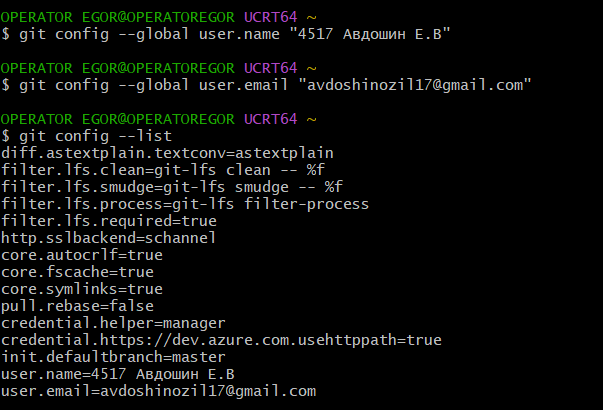
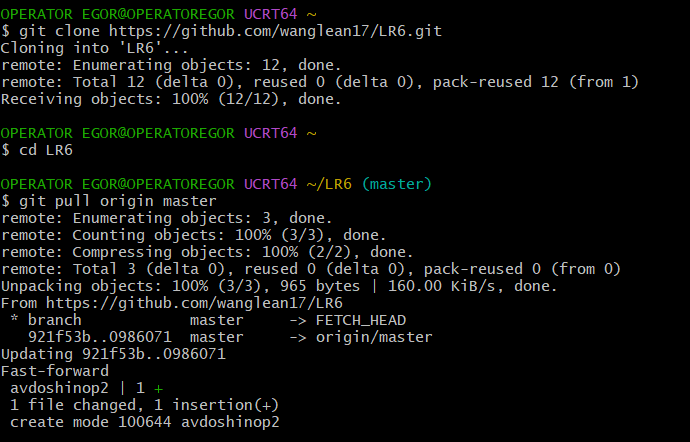
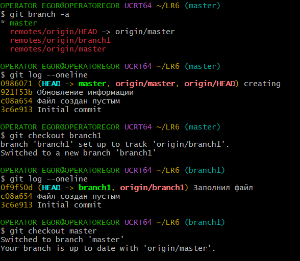
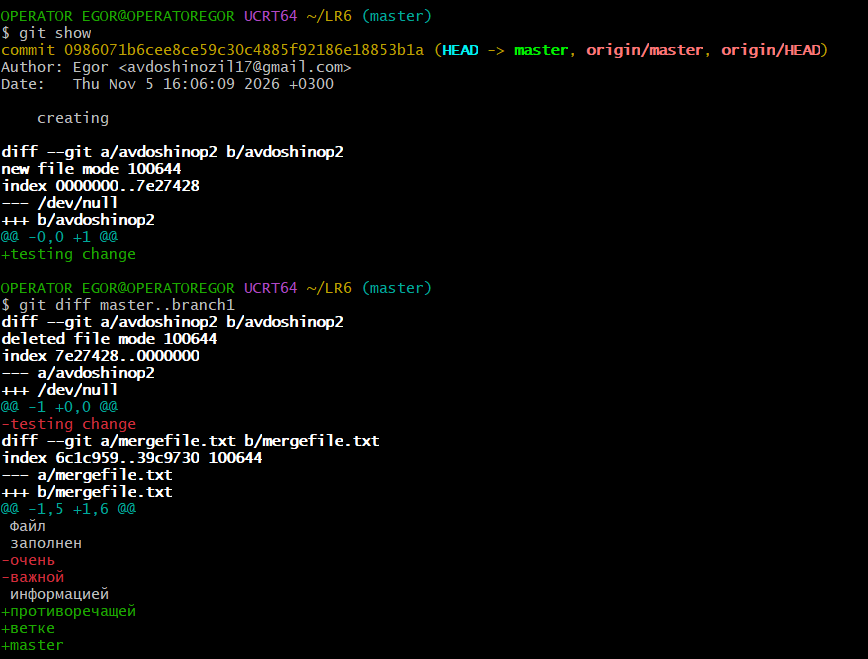
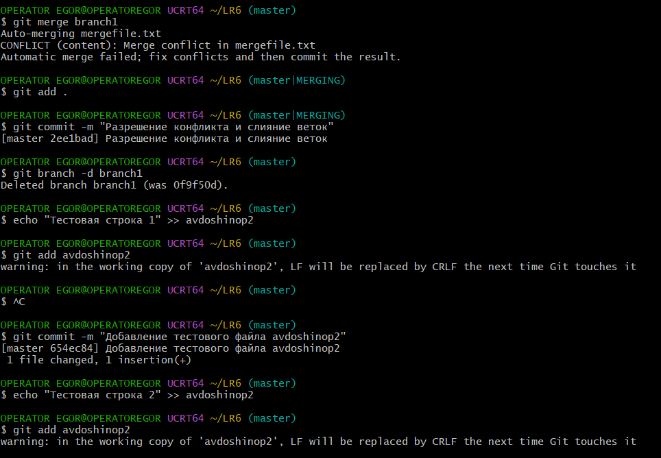
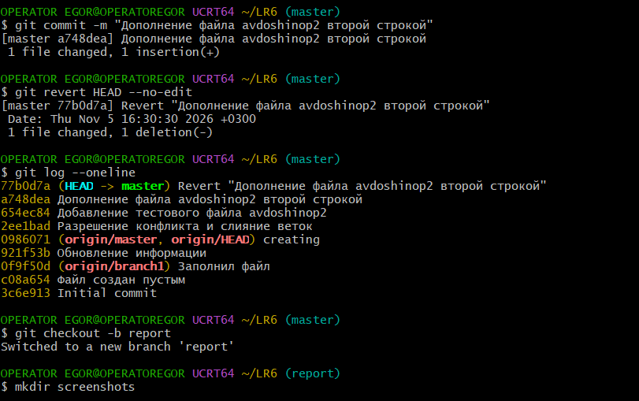

# Лабораторная работа №6: Система контроля версий Git

**Выполнил:** студент группы 4517 Авдошин Е.В.  
**Цель работы:** изучение базовых возможностей системы управления версиями, опыт работы с Git API, опыт работы с локальным и удаленным репозиторием.

---

## Ход работы

### 1. Настройка Git
Была выполнена первоначальная настройка клиента Git с указанием имени пользователя и email, а также проверен список конфигураций:


### 2. Клонирование и получение изменений
Выполнен fork репозитория, клонирование на локальный компьютер и подтягивание файла `avdoshinop2`, созданного через веб-интерфейс GitHub:


### 3. Работа с ветками
Просмотрен список доступных веток (`git branch -a`), выполнен переход в ветку `branch1`, изучена история коммитов обеих веток:


### 4. Просмотр изменений
Были исследованы последние изменения текущего коммита с помощью команды `git show`, а также выведена разница между ветками `master` и `branch1` через `git diff`:


### 5. Слияние веток и разрешение конфликта
Было запущено слияние ветки `branch1` в `master`. Возникший конфликт в файле `mergefile.txt` был разрешен вручную, изменения зафиксированы коммитом. После этого побочная ветка `branch1` была удалена:


### 6. Внесение изменений и откат коммита
В файл `avdoshinop2` были внесены последовательные изменения с отдельными комментариями. Затем был выполнен откат последнего коммита с помощью команды `git revert`:


---

## Лог команд

```bash
git config --global user.name "4517 Авдошин Е.В"
git config --global user.email "avdoshinozil17@gmail.com"
git config --list
git clone [https://github.com/wanglean17/LR6.git](https://github.com/wanglean17/LR6.git)
cd LR6
git pull origin master
git branch -a
git log --oneline
git checkout branch1
git log --oneline
git checkout master
git show
git diff master..branch1
git merge branch1
git add .
git commit -m "Разрешение конфликта и слияние веток"
git branch -d branch1
echo "Тестовая строка 1" >> avdoshinop2
git add avdoshinop2
git commit -m "Добавление тестового файла avdoshinop2"
echo "Тестовая строка 2" >> avdoshinop2
git add avdoshinop2
git commit -m "Дополнение файла avdoshinop2 второй строкой"
git revert HEAD --no-edit
git log --oneline
git checkout -b report
mkdir screenshots